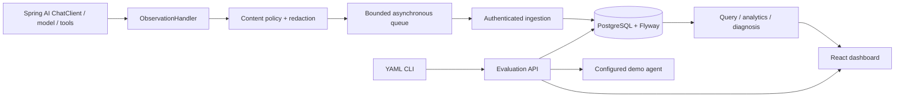

# Architecture

The checkout root is the AgentScope monorepo (repository name remains agenteval). The starter exports individual spans idempotently. Runs are aggregated by trace ID, supporting child-first delivery. Transport failures cause bounded retries and counted drops, never business failures. Server authentication uses separate optional ingest/read keys; local Compose binds published ports to loopback. Evaluation targets are server-configured, never arbitrary user-supplied URLs. Assertions evaluate actual tool observations returned by the deterministic demo, not canned trace fixtures. PostgreSQL stores evaluation reports and comparisons. Retention removes old traces and reports.

Milestones: starter → PostgreSQL APIs → dashboard → evaluations → deterministic Spring AI demo → containers → integration/CI → documentation/screenshots.
